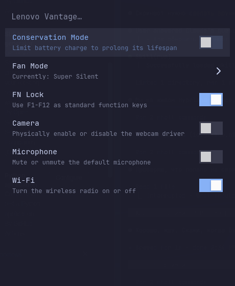

# Lenovo Vantage for KDE

A native Qt control panel for Lenovo laptop features on Linux. The interface uses standard Qt Widgets and does not impose its own colors, fonts, or dark mode: on KDE Plasma, Qt's platform theme integration supplies the active KDE style, color scheme, and system palette. Changes to the Plasma color scheme are picked up when the app is launched again.



## Features

* Battery Conservation Mode and Always-On USB
* Fan/thermal profile selection and Fn Lock
* Touchpad, camera, microphone, and Wi-Fi controls when available; touchpad toggling uses KWin's D-Bus interface on KDE Wayland and `xinput` on X11
* Searchable settings grouped into Power, Performance, and Devices
* Polkit-authorized hardware changes through a small privileged helper
* Optional Lenovo Vantage/Smart key binding as a KDE global shortcut

Hardware controls are based on [niizam/vantage](https://github.com/niizam/vantage). The KDE fork replaces the original GTK/libadwaita and Omarchy theme integration with Qt Widgets and follows the desktop's active Qt/KDE styling.

## Installation

On Debian or Ubuntu with KDE Plasma 6:

```bash
git clone https://github.com/yopaZH/omarchy-vantage.git kde-vantage
cd kde-vantage
sudo make install
```

The installer uses `apt` to install Python Qt bindings, KDE's Qt platform integration, Polkit, input utilities, NetworkManager, and the KDE shortcut tools. Launch **Lenovo Vantage** from the application launcher.

To bind the Lenovo Vantage/Smart key, run `vantage-bind-key` as your desktop user and press the key when prompted. On Plasma, this creates a KDE global shortcut that works in both Wayland and X11 sessions. Run `vantage-bind-key --unbind` to remove it. The helper also retains its Hyprland binding path for existing Omarchy setups.

## Uninstall

```bash
sudo make uninstall
```

## Requirements

Installed automatically by `sudo make install` on Debian/Ubuntu:

* `python3-pyside6.qtwidgets`
* `plasma-integration` (KDE's Qt platform theme integration)
* `polkitd` and `pkexec`
* `xinput`
* `network-manager`
* `wev` and `x11-utils` (key capture for Wayland and X11)
* `libkf6config-bin` and `libkf6service-bin` (KDE shortcut tools)
* `kmod` (camera module controls)

The app leaves the Qt style and palette untouched so Plasma's active color scheme, light/dark mode, and Breeze styling can flow through its platform theme integration. If launched outside KDE, Qt's normal platform defaults apply. In a KDE Wayland session, touchpad switching uses KWin over the user's D-Bus session; in X11 it uses `xinput`.
